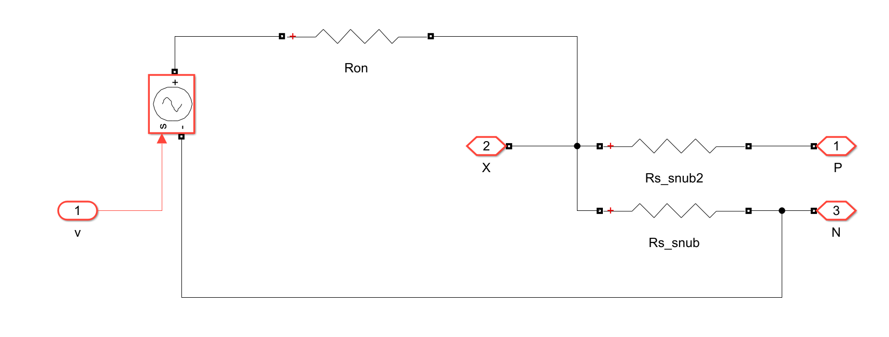
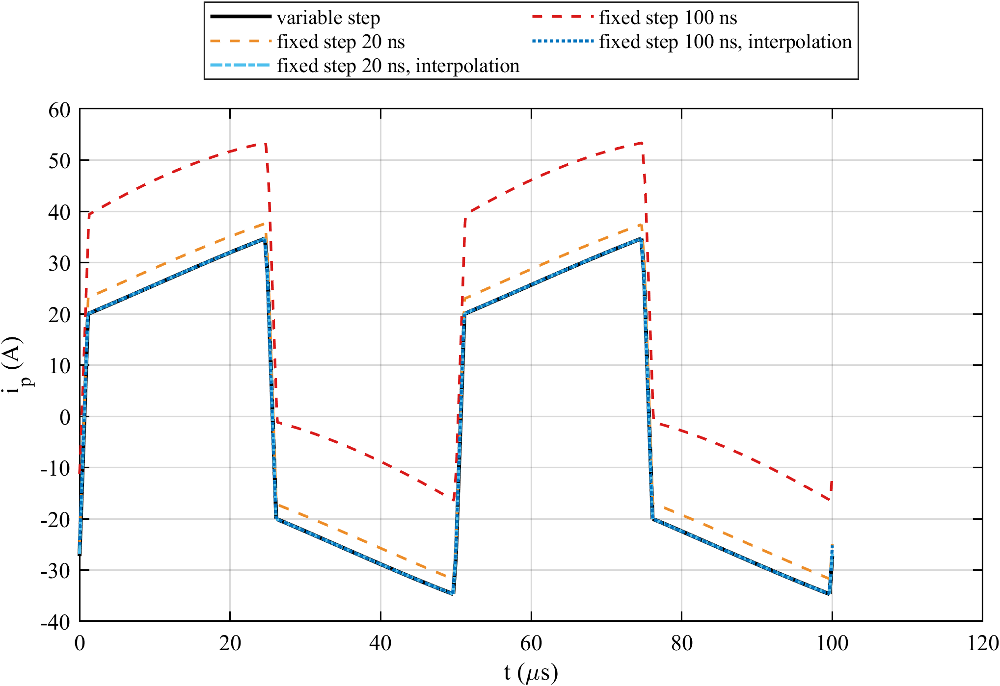
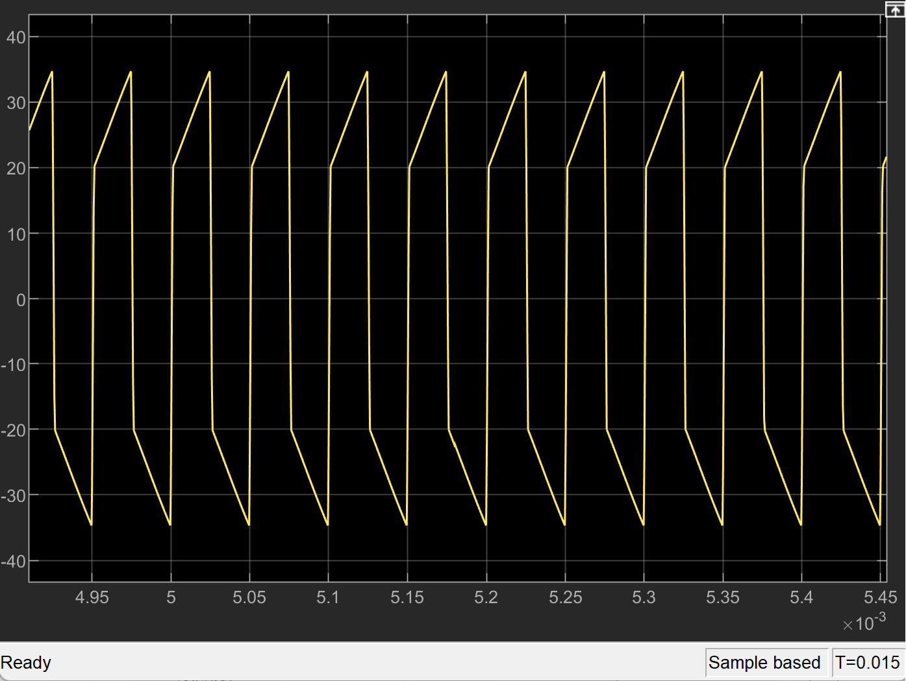
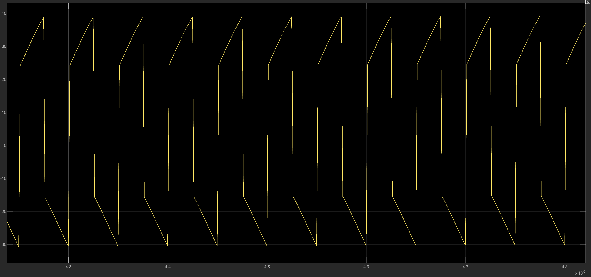
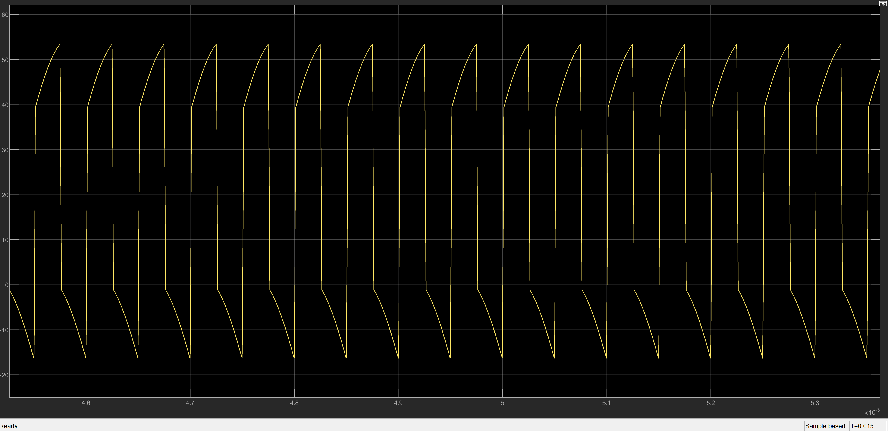
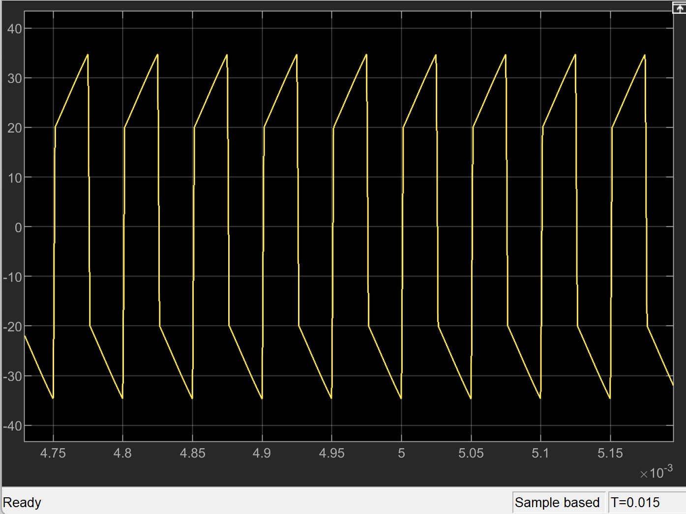
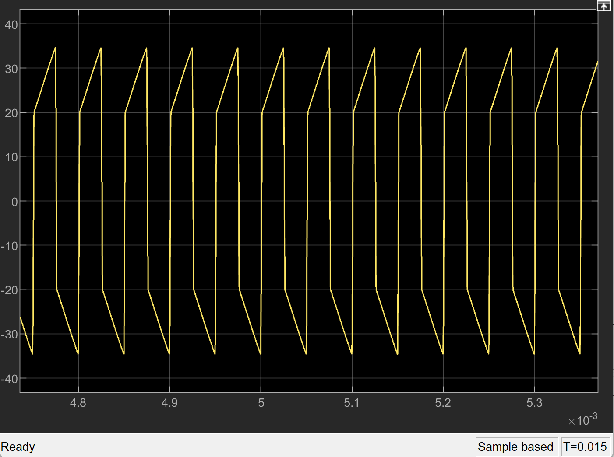

# Interpolated Switching for Fixed-Step Solvers in Real-Time Simulation of High Frequency Converters

## The real-time problem

Real-time and hardware-in-the-loop (HIL) simulators must run with a fixed time step. A gate edge that falls between two steps can only act at the next step, so the simulated converter switches slightly differently from the real one. A controller tested against such a model sees behaviour that comes from the solver, not from the converter. This project separates those solver artifacts from the converter behaviour and removes them with a fixed-step interpolated switch model, demonstrated on a 20 kHz dual active bridge (DAB).

## Contributions

1. **A way to isolate real-time solver artifacts.** The same circuit is simulated with an idealised variable-step reference and with a real-time fixed-step solver. Every difference from the reference is an artifact of the fixed-step simulation.
2. **A fixed-step interpolated bridge model.** A custom switch model accounts for switching events inside each time step and removes those artifacts while running with a purely fixed step, as a real-time target requires.
3. **Faster simulation with the same accuracy.** At 100 ns the interpolated model reproduces the reference waveform in about one fifth of the reference run time on the same PC.

## Converter and operating point

| Parameter | Value |
|---|---|
| Topology | Single-phase dual active bridge |
| Input voltage V_i | 800 V |
| Battery voltage V_2 | 450 V |
| Turns ratio n | 1.7 |
| Link inductance L_s / resistance R_s | 37.5 µH / 25 mΩ |
| Input filter L_i / R_i / C_i | 25 µH / 0.1 Ω / 75 µF |
| Output filter L_o / R_o / C_o | 25 µH / 0.1 Ω / 110 µF |
| Switching frequency f_s | 20 kHz |
| Dead time | 200 ns |
| Switch | R_on 3.5 mΩ, body diode V_f 3 V, R_d 8 mΩ |
| Modulation (fixed, open loop) | D1 = 0.985714, D2 = 1, D3 = 0.045188 |
| Operating point | about 20.4 kW, battery current about 44.9 A |

The same circuit and the same fixed modulation are used in every model. Only the solver and the switch model change.

## Approach

1. **Reference.** The converter is built with the Mosfet blocks of Simscape Electrical Specialized Power Systems and solved with a variable-step solver (ode23tb, maximum step 20 ns). The gate edges act at their exact times, so this model is the idealised reference.
2. **Real-time fixed step.** The same model is run with a fixed step of 20 ns and 100 ns (powergui Discrete, Tustin, no interpolation). The gates now act only at the time steps, as on a real-time target.
3. **Artifacts.** Comparing the fixed-step runs with the reference shows which effects come from the fixed-step solver.
4. **Fix.** The interpolated bridge model below is run at the same fixed steps and compared with the same reference.

All runs last 15 ms. The waveforms and values below are taken over the last two switching periods.

## Interpolated bridge implementation

In MATLAB R2024b, the Specialized Power Systems options "Interpolate switching events" and "Use time-stamped gate signals" could not be used with the switch blocks this converter needs: with interpolation the Mosfet block failed to compile, and with time-stamped gates the switch blocks gave a signal dimension mismatch. Interpolation worked only with a variable-step solver, which a real-time target cannot use. The bridge was therefore built as a custom switch model that runs with a purely fixed step.

**Gate block.** Once per switching period, `gate_core.m` computes the exact on-intervals of all eight switches from D1, D2, D3 and the dead time. The gates are passed on as switching times, not as on/off signals sampled at the step.

**Leg model.** Each bridge leg is a controlled voltage source in series with the on-resistance R_on, with the same resistive snubbers as the Mosfet blocks.

*Figure 1. Leg model of the interpolated bridge: a controlled voltage source set by the bridge block, in series with R_on, with resistive snubbers to the positive and negative rail.*

**Every fixed step**, the bridge block:
1. computes, for each switch, the fraction of the step it is on (T_ON / T_sim) from the exact switching times;
2. treats the rest of the step as dead time, where the body diode conducts on the high or low side depending on the current direction, with its knee voltage V_f and resistance R_d;
3. sets each leg voltage to the average over the step of what the real leg would produce;
4. draws the matching current from each DC bus through a controlled current source.

The block uses the bus voltages and currents of the previous step through a single unit delay. It needs no variable-step solver and no smaller step, so it stays compatible with fixed-step real-time simulation.

## Results

| Run | DC offset of the transformer current | Peak current + / − |
|---|---|---|
| Variable step (reference) | −0.0025 A | +34.69 / −34.69 A |
| Fixed step 20 ns | +3.09 A | +37.62 / −31.78 A |
| Fixed step 100 ns | +19.75 A | +53.36 / −16.37 A |
| Fixed step 20 ns, interpolation | +0.0036 A | +34.68 / −34.68 A |
| Fixed step 100 ns, interpolation | +0.0034 A | +34.64 / −34.63 A |

The fixed-step artifact is a lasting DC offset in the transformer current, which grows with the time step. With the interpolated bridge the transformer current matches the reference at both time steps.

*Figure 2. Transformer current over two switching periods. Black: variable-step reference. Orange dashed: fixed step 20 ns. Red dashed: fixed step 100 ns. Light blue dash-dot: fixed step 20 ns with interpolation. Blue dotted: fixed step 100 ns with interpolation. Both interpolated runs lie on the reference.*

*Figure 3. Transformer current, Simulink scope, variable-step reference.*

*Figure 4. Transformer current, Simulink scope, fixed step 20 ns.*

*Figure 5. Transformer current, Simulink scope, fixed step 100 ns.*

*Figure 6. Transformer current, Simulink scope, fixed step 20 ns with interpolation.*

*Figure 7. Transformer current, Simulink scope, fixed step 100 ns with interpolation.*

**Run time** for 15 ms of simulation on the same PC (offline, one run each):

| Run | Run time |
|---|---|
| Variable step (reference) | 39 s |
| Fixed step 20 ns / 100 ns | 13 s / 9 s |
| Fixed step with interpolation 20 ns / 100 ns | 8 s / 7 s |

## How to run

1. `init.m` holds all parameters, the operating point and the run length. The run scripts call it.
2. `run_variable_step.m` runs the reference and saves `result_variable_step.mat`.
3. `run_fixed_step_20ns.m` and `run_fixed_step_100ns.m` run the reference model with a fixed step and save `result_fixed_step_20ns.mat` and `result_fixed_step_100ns.mat`.
4. `run_fixed_step_interpolation_20ns.m` and `run_fixed_step_interpolation_100ns.m` run the interpolated model and save `result_fixed_step_interpolation_20ns.mat` and `result_fixed_step_interpolation_100ns.mat`.
5. `compare_openloop.m` prints the results table and saves `figures/link_current.png`.

Models: `dab_openloop_variable_step.slx` (reference, also used for the fixed-step runs) and `dab_openloop_fixed_step_interpolation.slx` (interpolated bridge). Both use `gate_core.m`.

## Skills

Real-time and HIL simulation · Fixed-step and variable-step solvers · Custom switch modelling in Simscape Electrical (Specialized Power Systems) · Dual active bridge converters · MATLAB / Simulink

## Reference

M. Stevic and R. Venugopal, "High-Fidelity Real-Time Simulation of Dual-Active Bridge Converters," PCIM Europe 2022.
